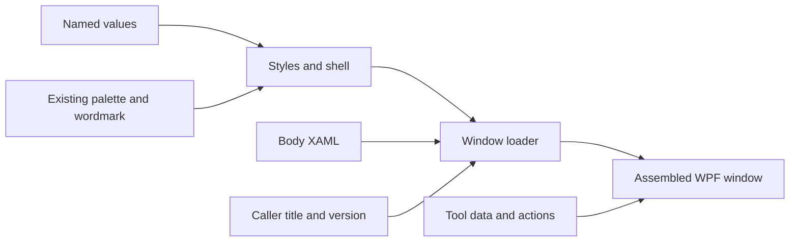

# KLCode Design System

This file records the current visual system used by the KLCode repository. It
covers the legacy IronPython/pyRevit dialogs, their DevSandbox gallery, and
the compiled WPF add-ins. It does not replace host-specific runtime validation.
The legacy source descriptions below were rechecked on 2026-10-08 at
`089da1b7d88e0df9dec2cc127659a24e051b9163`; see the
[design-system reviews](knowledge/reviews/design-system/README.md) for dated findings
and live-acceptance boundaries.

## Custom window foundation

The owner approved a shared custom-window standard on 2026-10-27 and refined
its five references on 2026-10-28. The production migration adopts that source
foundation in nine Python tool windows and five compiled windows. Gallery
continues to preview the Python sources; compiled previews remain deferred. The
[consolidation plan](plans/custom-window-consolidation.md) owns migration status.

| Role | Approved rule |
| --- | --- |
| Identity | Preserve charcoal/green and the existing outlined KLCode wordmark |
| Header/footer | Both 24 WPF units high; shared composition, not copied markup |
| Header | Wordmark left, centered title, text Close right; ellipsis without a tooltip |
| Footer | Functional shared Prototype/Outreach links; pure calling-tool version (vX.X) centered; omit missing versions; use Create from rooms green/gray |
| Typography | Segoe UI 12 body/controls, 14 header/main action/selection prompt; constant labels use Title Case; compact Close remains 10 |
| Buttons | Fixed 104 x 28 standard, 128 x 28 icon/text, and 216 x 32 wide main roles; preserve action placement |
| Controls | 32-high standard fields; 28-high compact controls; 24-high compact form fields; search field 24 high, matching Create from rooms |
| Spacing | 4/8/12/16/24 scale; body inset 16 horizontally, 8 below header/last action; sections 16, related controls 8, label-to-field 4 |
| Checkbox list | Create from rooms spacing: rows 20 high, 4-unit box-to-label gap; native KL&A list-selection row template supplies blue hover/selection; long names wrap |
| Icons | Approved Lucide geometry in `lib/_icons/gui/`; 16-unit normal size, 1.5 source stroke on a 24-unit canvas; semantic keys and inherited state colors |
| States | Shared hover/pressed/disabled/focus treatments, readable text and wrapped/scrollable long content |

`lib/GUI/Resources/KLCodeFoundationTokens.xaml` owns typed WPF token data.
`KLCodeFoundation.xaml` owns the shell and explicit control styles. It merges
event-free `KLCodeSharedPrimitives.xaml` for the canonical palette, outlined
wordmark, footer links and scrollbars. Both loose Python XAML and compiled WPF
package the same resources. Legacy `WPF_styles.xaml` remains unchanged for
docked/tooling consumers outside this migration. Focus, pressed and
disabled brushes supplement brand colors. Footer links and version
use the existing `footer_donate` and `text_gray` colors, per owner review.
Workflow data and host adapters remain separate from shared presentation.

`KLCodeComponents.xaml` merges the foundation and adds opt-in field/group,
readout, dropdown, radio/toggle, status/banner, table and splitter styles.
The [five reference templates](../lib/GUI/_templates/README.md) compose these
parts with safe Gallery presenters. The generic FindReplace example was adapted
into Form and its unused wrapper retired. Core tools retain their bundled body
XAML and behavior while adopting the common shell and components.

The owner refined Form's compact field role on 2026-10-28: 24-high inputs,
60-wide label and 240-wide input columns, 8-unit row gaps and 12-unit group
padding. Labels include colons and center vertically. Explicit compact styles
preserve standard-field sizing elsewhere. Form has inline validation and Reset/
Apply actions, with no Sample Preview. See the [Form refinement evidence](knowledge/reviews/design-system/2026-10-28-form-template-refinement.md).
Form's Edit Naming Rules heading uses the same `KlaFoundationPromptLabel` as
Selection's Select Elements prompt, including normal weight and zero padding.

Message fits its content up to a caller-defined height cap, then scrolls.
Details begins collapsed even for errors and remains a user choice when severity
changes. Heading/body text colors stay consistent; severity uses heading wording
and border color. Current reference defaults are 288 minimum/640 maximum height,
with 424 minimum while its 128-high Details readout is open. The opt-in shared
`fit_window_height` helper measures the chromeless shell without showing it.
See the [Message refinement evidence](knowledge/reviews/design-system/2026-10-28-message-template-refinement.md).

Review separates checked items from the selected row's right-hand detail pane.
Check All affects only eligible rows in the current filtered view; hidden checks
are retained and Apply Checked uses the full checked collection. Blocked rows
cannot be checked. Ready/Warning/Blocked chips center in their Status cells
through an opt-in cell style; other table columns retain their alignment.
See the [Review refinement evidence](knowledge/reviews/design-system/2026-10-28-review-template-refinement.md).

`GUI.window_chrome.load_window()` is a small Python adapter with no import-time
pyRevit/document dependency. It binds shared close/drag/navigation events;
the caller retains body data, showing/dismissal semantics and model operations.
For existing pyRevit WPFWindow subclasses it delegates loading to the installed
host's `load_xaml` API, preserving owner, icon, thread and Escape setup. An
optional close callback retains caller-specific cancellation. The compiled
`KLCode.Wpf.WindowChrome` adapter binds the same shell parts while preserving
CLR/localization, tool DataContext and lifecycle responsibilities.

The [main template guide](../lib/GUI/_templates/KLCodeSelectionTemplate.md) explains
the 432 x 576 reference and creating a new body. The
[first-delivery verification](knowledge/reviews/design-system/2026-10-27-custom-window-foundation.md)
contains actual WPF renders and proof limits. Native/pyRevit dialogs, ribbon
icon redesign and the five deferred compiled previews are outside this delivery.
The [owner-requested refinement](knowledge/reviews/design-system/2026-10-27-main-template-refinement.md)
records the current compact search/list spacing, footer appearance, prefix-free
version, and removal of the default-button outline.

### How the code fits together

WPF is the Windows interface toolkit. XAML describes what to draw; Python or
C# supplies data and handles user actions. The design system lets windows
assemble shared visual parts instead of copying their formatting.

| Layer | Plain-English job | Code owner |
| --- | --- | --- |
| Shared values | Names for sizes, gaps, fonts and state colors | [KLCodeFoundationTokens.xaml](../lib/GUI/Resources/KLCodeFoundationTokens.xaml) |
| Shared parts/frame | Styles format controls; templates draw their inner pieces/states; `KlaWindowShell` supplies header/footer around a body | [Foundation](../lib/GUI/Resources/KLCodeFoundation.xaml) and [Components](../lib/GUI/Resources/KLCodeComponents.xaml) |
| Window body | The tool's arrangement of search, fields, lists and actions | [Main template example](../lib/GUI/_templates/KLCodeSelectionTemplate.xaml) and each tool's own XAML |
| Assembly/events | Load the resources/body and connect Close, dragging and footer navigation | [window_chrome.py](../lib/GUI/window_chrome.py) |
| Caller identity | Supply title, pure tool version and shared link destinations | [window_metadata.py](../lib/GUI/window_metadata.py) |
| Tool logic | Supply data, filtering/validation, showing/lifetime and Revit operations | Each tool's Python/C# code |
| Review harness | Use the real visual source with fictional data and simulated actions | `lib/ui_gallery/` and UI Gallery |

For example, `Height="{StaticResource KlaControlHeight}"` means "look up the
standard height" rather than writing `32` into each form. The main template is
a working example assembled from those parts. Its body references shared
styles; the shell draws the header/footer. The loader does not show a window,
query a document or replace the tool's DataContext. The caller retains those
responsibilities. A common appearance does not imply a common selection rule.

The nine Python tool windows and five references consume the same foundation
and components. Compiled windows use `KLCode.Wpf` aliases and `ThemeBootstrapper`
with links to those canonical XAML sources; C# retains its event/localization
adapter. A shared style change therefore reaches both source implementations.
Legacy `WPF_styles.xaml` remains for docked/tooling consumers, including the
Gallery catalog's own shell. Standalone Recall uses a separate body so its
docked consumer retains its existing appearance. The
[production migration review](knowledge/reviews/design-system/2026-10-29-production-migration.md)
records construction/layout evidence and remaining build/host limits.

The [2026-10-28 component review](knowledge/reviews/design-system/2026-10-28-custom-window-components-review.md)
maps the missing parts. The shared Close style now moves its text upward by one
unit for optical centering in the fixed 18-unit control; the WPF probe measures
the visible glyph bounds rather than only the surrounding text box.

## Master Design Colors

These are the named colors used across KLCode ribbon icons and WPF GUIs. This table defines the color names used throughout this document; usage guidance belongs in the relevant icon and GUI sections.

| KLName | Value | Description |
| --- | --- | --- |
| KLCharcoal | `#1A252B` | Dark blue-green charcoal |
| KLGreen | `#33714F` | Deep KLCode green |
| KLGreen-dark | `#286048` | Dark muted green |
| KLGreen-secondary | `#407058` | Muted medium green |
| KLOrange | `#FF8000` | Bright orange |
| KLWhite | `#E5E4E2` | Soft warm off-white |
| white | `#FFFFFF` | Pure white |
| gray | `#808080` | medium gray |
| KLGray-dark | `#FF3F3F3F` | Dark neutral gray |
| KLCharcoal-gray | `#FF4F4F4F` | Medium-dark charcoal gray |
| KLGray-scroll | `#505050` | Neutral dark gray |
| KLGray-disabled | `#888888` | Muted medium-light gray |
| KLGray-disabled-check | `#FF6C6C6C` | Muted gray |
| KLCharcoal-black | `#FF131313` | Nearly black charcoal |
| black | `#000000` | Pure black |
| KLGreen-transparent-a | `#33286048` | Transparent dark green |
| KLGreen-transparent-b | `#33307050` | Transparent muted green |
| KLGreen-checkbox-a | `#88286048` | Semi-transparent dark green |
| KLGreen-checkbox-b | `#99307050` | Semi-transparent muted green |
| warning-gold | `#DAA520` | Warm golden yellow |
| info-green | `#3CB371` | Medium sea green |

`lib/GUI/Resources/KLCode_palette.xaml` supplies the named palette consumed by
the compiled-WPF adapter: `src/KLCode.Wpf/KLCode.Wpf.csproj` links it as
`Resources/KLCodePalette.xaml`, which `KLCodeControls.xaml` merges. The legacy
`WPF_styles.xaml` dictionary currently
repeats the same legacy brush values rather than merging that file. The
repository wordmark asset is `lib/_logos/KLCode_text_1024x256px.svg` (with a
PNG export). The palette consolidation decision and test-contract mismatch are
recorded in the [current-state review](knowledge/reviews/design-system/2026-10-08-current-state-review.md).

| Property | Value |
| --- | --- |
| KLCharcoal sample | `#1A252B` |
| KLGreen sample | `#33714F` |
| KLGreen-dark sample | `#286048` |
| KLGreen-secondary sample | `#407058` |

## Icons

### In-window GUI icons

Approved GUI artwork lives in [lib/_icons/gui](../lib/_icons/gui/README.md).
Original SVGs, a pinned source manifest and Lucide/Feather license notices stay
together. `scripts/generate_gui_icons.py` produces `KLCodeIcons.xaml`; do not
edit that generated dictionary manually. Python and compiled adapters consume
the same geometry/ImageSource resources, without a runtime SVG dependency.

Use semantic keys such as `KlaSearchGeometry` or `KlaIconSearch`, rather than
per-window file paths. `KlaGuiIcon` inherits its control's foreground and has a
disabled treatment. Both render paths retain the full 24-unit source bounds.
Keep 16 units for ordinary icons; the review sheet's 32-unit versions are
enlargements. Recall and Family Studio use the approved functional mappings;
message headings may show information/warning/error/success symbols as
applicable. Status chips retain words and borders. Larger Browse, Reset, Copy
and Open Folder buttons remain text-only.

### Ribbon assets

KLCode ribbon icons are transparent-background PNGs. Use a single foreground color unless the command clearly needs additional visual detail.

### Source Assets

Reusable source icons live in `lib/_icons/`. Keep source assets at `96 x 96 px` or smaller. Export command icons at the size needed by the bundle, usually `32 x 32 px` for large ribbon buttons.

Name reusable source icons with a descriptive lowercase icon name, size, and color: `<icon-name>_<size>px_<color>.png`, such as `drill_32px_orange.png`.

| Color name | Color | File reference |
| --- | --- | --- |
| KLOrange | `#FF8000` |  `<icon-name>_<size>px_orange.png` |
| KLGreen | `#33714F` |  `<icon-name>_<size>px_green.png` |
| KLWhite | `#E5E4E2` |  `<icon-name>_<size>px_light.png` |
| KLCharcoal | `#1A252B` |  `<icon-name>_<size>px_dark.png` |

### Standard Sizes

| Size | Use |
| --- | --- |
| `16 x 16 px` | small/stacked controls |
| `24 x 24 px` | medium controls |
| `32 x 32 px` | normal command icons |
| `96 x 96 px` | reusable source/max size |

### Design Reference

Use [Lucide Icons](https://lucide.dev/icons/) as the visual reference for new or refreshed ribbon icons: simple outline shapes, clear silhouettes, and consistent stroke weight.

### Prototype Icons

New prototype scripts should start with `lib/_icons/drill_32px_orange.png` as the default icon. Prototype-only exceptions should stay local to the prototype bundle until they are promoted.

## GUI Colors

`lib/GUI/Resources/WPF_styles.xaml` defines the legacy pyRevit brush keys and
control templates. `lib/GUI/Resources/KLCode_palette.xaml` carries matching
palette keys for compiled WPF, and
`src/KLCode.Wpf/Resources/KLCodeControls.xaml` merges that compiled palette.
The legacy and compiled palette values are currently defined in separate files.

| Token | Value | KLName |
| --- | --- | --- |
| `window_background` | `#1A252B` | KLCharcoal |
| `header_background` | `#1A252B` | KLCharcoal |
| `text_white` | `#E5E4E2` | KLWhite |
| `text_gray` | `Gray` | gray |
| `text_green` | `#33714F` | KLGreen |
| `button_fg_normal` | `White` | white |
| `button_bg_normal` | `#286048` | KLGreen-dark |
| `button_bg_hover` | `#407058` | KLGreen-secondary |
| `border_green_dark` | `#286048` | KLGreen-dark |
| `border_green` | `#33714F` | KLGreen |
| `uncheckbox_checked_colour` | `Gray` | gray |
| `checkbox_checked_colour` | `#286048` | KLGreen-dark |
| `footer_donate` | `#407058` | KLGreen-secondary |

## Legacy GUI Properties

These values describe existing `WPF_styles.xaml` consumers, not the new
opt-in foundation. Its wordmark, close/action controls, filter, checkbox, list
and scrollbar rules apply through `my_WPF.add_wpf_resource()` unless locally
overridden. The approved standard and migration status are described above.

Most reusable dialogs, including the two Find and Replace prototypes, load the shared dictionary through `my_WPF.add_wpf_resource()`. The View Range editor instead uses `forms.WPFWindow` with its own `Window.Resources`; after loading it assigns the shared `KLCodeWordmark` template to `wordmark_host` in Python. The UI Gallery is a separate DevSandbox surface with its own local resources.

### Color Properties

The unqualified `ComboBox` and `ComboBoxItem` rows below describe the legacy
shared styles in `WPF_styles.xaml`. View Range and the compiled WPF adapter have
different templates, summarized under [ComboBox implementation boundaries](#combobox-implementation-boundaries).

| Control | UI part | XAML property | Implementation value | KLName |
| --- | --- | --- | --- | --- |
| `Button` | default | `Background` | `button_bg_normal` | KLGreen-dark |
| `Button` | default | `Foreground` | `button_fg_normal` | white |
| `Button` | hover state | `Background` | `button_bg_hover` | KLGreen-secondary |
| `TextBlock` | default | `Foreground` | `text_white` | KLWhite |
| `TextBox` | default | `Background` | `header_background` | KLCharcoal |
| `TextBox` | default | `Foreground` | `text_white` | KLWhite |
| `TextBox` | default | `BorderBrush` | `border_green` | KLGreen |
| Search filter | icon | `Source` | `lib/_icons/search_16px_light.png` | light search icon |
| Search filter | field | `Style` | `KLCodeFilterTextBox` inside a 1 px KLGreen, 6 px-radius shell | KLCharcoal / KLGreen |
| `Label` | default | `Foreground` | `text_green` | KLGreen |
| `CheckBox` | label text | `Foreground` | `White` | white |
| `CheckBox` | unchecked box | `Background` | `window_background` | KLCharcoal |
| `CheckBox` | unchecked box | `BorderBrush` | `text_green` | KLGreen |
| `CheckBox` | checked box | `Background` | `checkbox_checked_colour` | KLGreen-dark |
| `CheckBox` | checkmark | `Stroke` | `#E5E4E2` | KLWhite |
| `CheckBox` | hover checkbox fill | `Background` | `button_bg_hover` | KLGreen-secondary |
| `ComboBox` | default | `Foreground` | `White` | white |
| `ComboBox` | selector body | `Background` | `header_background` | KLCharcoal |
| `ComboBox` | selector border | `BorderBrush` | `border_green` | KLGreen |
| `ComboBox` | arrow | `Fill` | `White` | white |
| `ComboBox` | disabled selected text | `Foreground` | `#888888`; selector body and arrow have no disabled override | KLGray-disabled |
| `ComboBox` | dropdown body | `Background` | `header_background` | KLCharcoal |
| `ComboBox` | dropdown border | `BorderBrush` | `border_green` | KLGreen |
| `ComboBox` | editable text field | `Background` | `#FF3F3F3F` | KLGray-dark |
| `ComboBox` | editable text field | `Foreground` | `#E5E4E2` | KLWhite |
| `ComboBoxItem` | default | `Foreground` | `White` | white |
| `ComboBoxItem` | highlighted state | `Background` | `#FF4F4F4F` | KLCharcoal-gray |
| `DataGrid` (UI Gallery local override) | default | `Background` | `header_background` | KLCharcoal |
| `DataGrid` (UI Gallery local override) | default | `Foreground` | `text_white` | KLWhite |
| `DataGrid` (UI Gallery local override) | border/grid lines | `BorderBrush`/`HorizontalGridLinesBrush` | `border_green_dark` | KLGreen-dark |
| `DataGrid` (UI Gallery local override) | alternate row | `AlternatingRowBackground` | `#FF131313` | KLCharcoal-black |
| `DataGridColumnHeader` (UI Gallery local override) | default | `Background` | `border_green_dark` | KLGreen-dark |
| `DataGridColumnHeader` (UI Gallery local override) | default | `Foreground` | `text_white` | KLWhite |
| `DataGridCell` (UI Gallery local override) | selected state | `Background` | `button_bg_hover` | KLGreen-secondary |
| `DataGridCell` (UI Gallery local override) | selected state | `Foreground` | `button_fg_normal` | white |
| `ListBox` | default | `Background` | `header_background` | KLCharcoal |
| `ListBox` | default | `BorderBrush` | `border_green_dark` | KLGreen-dark |
| `ScrollBar` | default | `Background` | `window_background` | KLCharcoal |
| `ScrollBar` | default | `Foreground` | `window_background` | KLCharcoal |
| `ScrollBar` | default | `BorderBrush` | `header_background` | KLCharcoal |
| `ScrollBarThumbVertical` | default | `Background` | `text_green` | KLGreen |
| `ContentControl` | header wordmark | `ContentTemplate` | `KLCodeWordmark`; `70 x 12`; `Margin=8,0,0,0` | outlined KLCode wordmark |

### Layout And Behavior Properties

| Control | UI part | XAML property | Implementation value |
| --- | --- | --- | --- |
| `Button` | default | `TextElement.FontFamily` | `Arial` |
| `Button` | default | `Cursor` | `Hand` |
| `Button` | button border | `CornerRadius` | `8` |
| `Button` | compact header close | `Style` | `KLCodeCloseButton`; `60 x 18`; 6 px radius |
| `Button` | action button | `Style` | `KLCodeActionButton`; 8 px radius |
| `TextBox` | default | `VerticalContentAlignment` | `Center` |
| `TextBox` | border style | `CornerRadius` | `5` |
| `Border` | default | `BorderThickness` | `1` |
| `Border` | default | `CornerRadius` | `10` |
| `CheckBox` | checkbox box | `Width` and `Height` | `16 x 16` |
| `CheckBox` | checkbox box | `CornerRadius` | `2` |
| `DockPanel` | default | `Margin` | `2` |
| `ComboBox` | default | `MinWidth` | `120` |
| `ComboBox` | default | `MinHeight` | `20` |
| `ComboBox` | shared toggle template key | `x:Key` | `ComboBoxToggleButton` |
| `ComboBox` | editable text host key | `x:Key` | `ComboBoxTextBox` |
| `ComboBoxItem` | shared item template padding | `Padding` | `2` |
| `DataGrid` | headers shown | `HeadersVisibility` | `Column` |
| `DataGrid` | selection mode | `SelectionMode` | `Single` |
| `DataGrid` | row resize | `CanUserResizeRows` | `False` |
| `DataGridColumnHeader` (UI Gallery local) | header padding | `Padding` | `8,6` |
| `DataGridCell` (UI Gallery local) | cell padding | `Padding` | `6,4` |
| `ListBox` | default | `ScrollViewer.VerticalScrollBarVisibility` | `Visible` |
| `ListBox` | default | `ScrollViewer.HorizontalScrollBarVisibility` | `Hidden` |
| `ListBox` | border style | `CornerRadius` | `10` |
| `ScrollBar` | default | `Opacity` | `0.9` |
| `ScrollBar` | default | `Margin` | `3` |
| `ScrollBar` | track border | `CornerRadius` | `10` |
| `ScrollBarThumbVertical` | thumb border | `CornerRadius` | `8` |

Selection-style branded windows use `text_white` for the filter label or icon, filter input text, and selection prompt label. Borders and separators remain on KLGreen/KLGreen-dark accents so labels such as `Select stories to review:` stay readable against the KLCharcoal background.

The View Range editor uses a command-local dark `ComboBox` template for the Associated Level selectors because shallow brush setters leave the native WPF selector surface light in Revit. The selector body, arrow well, popup border, and `ComboBoxItem` highlight all use KLCode token values.

The DevSandbox UI Gallery uses command-local `DataGrid` styles because table styling is not yet part of the shared WPF dictionary. Its catalog grid keeps the dark KLCharcoal body, KLGreen-dark header/grid lines, KLCharcoal-black alternating rows, and KLGreen-secondary selected cells.

### ComboBox implementation boundaries

| Implementation | Source | Arrow | Disabled behavior | Item padding |
| --- | --- | --- | --- | --- |
| Legacy shared | `lib/GUI/Resources/WPF_styles.xaml` | Literal `White` | Selected text changes to `#888888`; the selector body and arrow have no disabled override. | `2` |
| View Range local | `KL&A Tools_dev.tab/03 Core Tools.panel/ViewRange.pushbutton/MainWindow.xaml` | `text_white` | Selector body changes to `#FF131313`; arrow and selected text use `text_gray`. | `4,3` |
| Compiled WPF | `src/KLCode.Wpf/Resources/KLCodeControls.xaml` | `text_green` | Selected text uses `KlaDisabledTextBrush` and selector opacity becomes `0.55`; no separate arrow/body disabled override. | `7,4` |

These are separate source contracts. The View Range values do not describe the
shared legacy template, and none of these source values establishes rendered
behavior in a live Revit host.

### Window Defaults

The shared GUI windows follow these conventions where present:

| Property | Implementation value | KLName |
| --- | --- | --- |
| `WindowStartupLocation` | `CenterScreen` | N/A |
| `HorizontalAlignment` | `Center` | N/A |
| `WindowStyle` | `None` | N/A |
| `ResizeMode` | `NoResize` for fixed dialogs | N/A |
| Header row height | `24` | N/A |
| Header edge columns | `86` | Reserves the title's centered visual lane |
| Search row height | `32` for list-selection windows | N/A |
| Header background | `header_background` | KLCharcoal |
| Close button size | `60 x 18` | N/A |

Command-local windows that use `forms.WPFWindow`, including the View Range editor and UI Gallery, keep the same chrome event names as shared windows: `button_close` for the header close button and `header_drag` for dragging the borderless header.

## Compiled WPF Add-in System

The compiled add-ins use a CLR host adapter rather than loading the IronPython
base class. Their project links the canonical palette, shared primitives,
foundation, tokens, components and GUI icon dictionary as WPF resources,
preserving relative resource paths. Compiled-only names remain compatibility
aliases or workflow-specific bindings, rather than copied control templates.

| Layer | Source | Responsibility |
| --- | --- | --- |
| Compiled palette | `lib/GUI/Resources/KLCode_palette.xaml` | Named brush keys matching the legacy palette, such as `header_background`, `text_white`, and `button_bg_normal`. |
| Compiled semantic aliases | `src/KLCode.Wpf/Resources/KLCodeCompiledTokens.xaml` | Existing compiled names map to canonical shared role colors. |
| Compiled control aliases | `src/KLCode.Wpf/Resources/KLCodeControls.xaml` | Existing style keys derive from shared Foundation/Components roles. |
| Compiled chrome adapter | `src/KLCode.Wpf/WindowChrome.cs` | Wire common named shell parts while preserving caller-owned showing, closing, locale and workflow data. |
| Shared compiled alert | `src/KLCode.Wpf/Views/KlaAlertWindow.xaml` | Reusable information and warning dialog used by compiled Revit commands. |

Compiled windows use the same outlined vector wordmark and shell as Python
windows. Actual tool versions are caller-owned and displayed without a Version
prefix; shared alerts omit unknown versions or retain their owner's identity.

### Compiled WPF Windows

| Window | XAML path | Invoked by | Size | Gallery status |
| --- | --- | --- | --- | --- |
| KL&A compiled alert | `src/KLCode.Wpf/Views/KlaAlertWindow.xaml` | Family Studio and Startup Importer commands | `440 x 300` | Catalog only; requires the compiled Revit host. |
| Family Studio | `src/KLCode.FamilyStudio/Revit/KLCode.FamilyStudio.Revit/Views/FamilyStudioWindow.xaml` | `KLCode.FamilyStudio.Revit.Commands.FamilyStudioCommand` | `1180 x 740` | Catalog only; requires the compiled Revit host. |
| Startup Importer source picker | `src/KLA.ModelStartupImporter/KLA.ModelStartupImporter.UI/Views/StartupSourcePickerWindow.xaml` | `KLA.ModelStartupImporter.Revit.StartupImportCommand` | `560 x 470` | Catalog only; requires the compiled Revit host. |
| Startup Importer review | `src/KLA.ModelStartupImporter/KLA.ModelStartupImporter.UI/Views/StartupImportReviewWindow.xaml` | `KLA.ModelStartupImporter.Revit.StartupImportCommand` | `860 x 640` | Catalog only; requires the compiled Revit host. |
| Startup Importer blocking issues | `src/KLA.ModelStartupImporter/KLA.ModelStartupImporter.UI/Views/BlockingIssuesWindow.xaml` | `KLA.ModelStartupImporter.Revit.StartupImportCommand` | `560 x 520` | Catalog only; requires the compiled Revit host. |

## Windows

**Canonical example:** `lib/GUI/_templates/KLCodeSelectionTemplate.xaml` is the
opt-in foundation reference. It consumes shared shell/control styles instead
of copying chrome. `SelectFromDict.xaml` remains the existing production
list-selection implementation and has not yet been migrated.

The following 9 user-facing KL&A custom windows use the template header
treatment: four shared GUI windows, Match Properties Recall, View Range, the
two Core Find and Replace windows, and Steel PSF. The former shared rename
forms were removed on 2026-10-28 at the owner's request. The DevSandbox UI Gallery and its
preview fixture are tooling exceptions and are not part of this visual
standardization scope.

### Shared GUI Windows

| Window | XAML path | Loader path | Tools |
| --- | --- | --- | --- |
| KL&A list selection | `lib/GUI/SelectFromDict.xaml` | `lib/GUI/SelectFromDict.py` | `Carbon GWP Pull.pushbutton`; `Concrete Mix Header.pushbutton`; `Create Detail Folders.pushbutton`; `Hide Revision Clouds.pushbutton`; `Highlight Changed Elements.pushbutton`; `Inspect Schedule Header.pushbutton`; `UI Gallery.pushbutton` |
| KL&A alert | `lib/GUI/CustomAlert.xaml` | `lib/GUI/CustomAlert.py` | `UI Gallery.pushbutton` |
| Duplicate sheets | `lib/GUI/DuplicateSheets.xaml` | `lib/GUI/DuplicateSheets.py` | `duplicate_sheets.pushbutton`; `UI Gallery.pushbutton` |
| Create from rooms | `lib/GUI/Tools/CreateFromRooms.xaml` | `lib/GUI/Tools/CreateFromRooms.py` | `UI Gallery.pushbutton` |

### Core Rename Windows

| Window | XAML path | Loader path | Tools |
| --- | --- | --- | --- |
| Find and replace views | `KL&A Tools_dev.tab/03 Core Tools.panel/Rename.pulldown/FindReplace - Views.pushbutton/Script.xaml` | Same bundle `script.py` | `FindReplace - Views.pushbutton`; `UI Gallery.pushbutton` |
| Find and replace sheets | `KL&A Tools_dev.tab/03 Core Tools.panel/Rename.pulldown/FindReplace_Sheets.pushbutton/Script.xaml` | Same bundle `script.py` | `FindReplace_Sheets.pushbutton`; `UI Gallery.pushbutton` |

### One-Off Windows

| Window | XAML path | Loader path | Tools | Reason to remain outside `lib/GUI` |
| --- | --- | --- | --- | --- |
| Match properties recall | `lib/match/clipboard_window.xaml` | `lib/match/clipboard.py` | `UI Gallery.pushbutton` | A modeless content host coupled to the Match Properties workflow and its localized clipboard content. It uses the shared palette but is not a reusable dialog family. |
| View range editor | `KL&A Tools_dev.tab/03 Core Tools.panel/ViewRange.pushbutton/MainWindow.xaml` | `KL&A Tools_dev.tab/03 Core Tools.panel/ViewRange.pushbutton/script.py` | `ViewRange.pushbutton`; `UI Gallery.pushbutton` | A command-specific, data-bound editor that uses KLCode design tokens locally while keeping pyRevit's command-window loader, bindings, and events. |

### Prototype Windows

| Window | XAML path | Loader path | Tools |
| --- | --- | --- | --- |
| Steel PSF story selection | `KL&A Tools_dev.tab/05 DevSandbox.panel/Prototype.pulldown/Steel PSF.pushbutton/SteelPsfDialog.xaml` | `KL&A Tools_dev.tab/05 DevSandbox.panel/Prototype.pulldown/Steel PSF.pushbutton/script.py` | `Steel PSF.pushbutton`; `UI Gallery.pushbutton` |
| UI Gallery | `KL&A Tools_dev.tab/05 DevSandbox.panel/Prototype.pulldown/UI Gallery.pushbutton/Gallery.xaml` | `KL&A Tools_dev.tab/05 DevSandbox.panel/Prototype.pulldown/UI Gallery.pushbutton/script.py` | `UI Gallery.pushbutton` |
| UI Gallery preview fixture | `KL&A Tools_dev.tab/05 DevSandbox.panel/Prototype.pulldown/UI Gallery.pushbutton/fixtures/PreviewFixture.xaml` | `KL&A Tools_dev.tab/05 DevSandbox.panel/Prototype.pulldown/UI Gallery.pushbutton/script.py` | `UI Gallery.pushbutton` |

## UI Gallery source review

The DevSandbox UI Gallery records 21 repository `Window` XAML surfaces: the
11 production/tooling Python windows, five reference templates, and
the five compiled WPF windows cataloged above. The compiled entries remain
disabled by the owner's 2026-10-27 scope decision; working compiled previews are
future work. Standard pyRevit/native dialogs are external sources, not
repository XAML surfaces. The Gallery now labels origins, lists source-backed
calling tools, and offers interactive fictional states for supported windows.
It also catalogs newly discovered Window sources without enabling arbitrary XAML.
Search combines with Origin and Preview availability filters; the latter uses
the current catalog statuses independently of the fictional state selector.
See the [current Gallery SPEC](<../KL&A Tools_dev.tab/05 DevSandbox.panel/Prototype.pulldown/UI Gallery.pushbutton/SPEC.md>)
and [verification record](knowledge/reviews/design-system/2026-10-27-ui-gallery-verification.md)
for current behavior and evidence.

The table below is a historical pre-migration snapshot. Current implementation
is described above and in the consolidation plan. The linked audit describes
2026-10-08; the rename rows below were
updated for the 2026-10-09 Core promotion. This table does not
establish rendered appearance, keyboard behavior, DPI behavior, or live Revit
acceptance. See the [dated design-system review](knowledge/reviews/design-system/2026-10-08-current-state-review.md#ui-gallery-theme-audit)
for the full audit, drift notes, and recommended actions.

| Window | Historical source status | Detail |
| --- | --- | --- |
| Create from rooms | Shared styles with a local list override | [Audit](knowledge/reviews/design-system/2026-10-08-current-state-review.md#ui-gallery-theme-audit) |
| KL&A alert | Shared KLCode styles | [Audit](knowledge/reviews/design-system/2026-10-08-current-state-review.md#ui-gallery-theme-audit) |
| Duplicate sheets | Shared styles with a local checkbox override | [Audit](knowledge/reviews/design-system/2026-10-08-current-state-review.md#ui-gallery-theme-audit) |
| Find and replace | Shared KLCode styles | [Audit](knowledge/reviews/design-system/2026-10-08-current-state-review.md#ui-gallery-theme-audit) |
| Find and replace sheets | Promoted Core dialog with shared KLCode styles and a local result panel | [Promotion record](knowledge/reviews/releases/2026-10-08/find-replace-promotion.md) |
| Legacy sheet rename form | Prior shared presentation retained for historical preview | [Source audit](knowledge/reviews/design-system/2026-10-08-current-state-review.md#ui-gallery-theme-audit) |
| Find and replace views | Promoted Core dialog with shared KLCode styles and a local result panel | [Promotion record](knowledge/reviews/releases/2026-10-08/find-replace-promotion.md) |
| Legacy view rename form | Prior shared presentation retained for historical preview | [Source audit](knowledge/reviews/design-system/2026-10-08-current-state-review.md#ui-gallery-theme-audit) |
| Match properties recall | Shared styles; Gallery now preserves the shell and actual clipboard content with simulated handlers | [Current verification](knowledge/reviews/design-system/2026-10-27-ui-gallery-verification.md) |
| KL&A list selection | Production reference for shared list-selection styling | [Audit](knowledge/reviews/design-system/2026-10-08-current-state-review.md#ui-gallery-theme-audit) |
| Steel PSF story selection | Shared styles in a DevSandbox selector | [Audit](knowledge/reviews/design-system/2026-10-08-current-state-review.md#ui-gallery-theme-audit) |
| View range editor | Command-local dark resources and ComboBox templates | [Audit](knowledge/reviews/design-system/2026-10-08-current-state-review.md#ui-gallery-theme-audit) |
| UI Gallery | Command-local palette and DataGrid styles | [Audit](knowledge/reviews/design-system/2026-10-08-current-state-review.md#ui-gallery-theme-audit) |
| UI Gallery preview fixture | Minimal test fixture without shared KLCode chrome | [Audit](knowledge/reviews/design-system/2026-10-08-current-state-review.md#ui-gallery-theme-audit) |

## Legacy Style Loading And Local GUI Overrides (historical)

The opt-in reference is `lib/GUI/_templates/KLCodeSelectionTemplate.xaml`, 432 x 576
with `KlaWindowShell` and new explicit foundation styles. Its title uses the
flexible center column; header/footer heights remain 24. The inventory below
describes older loading paths and copied chrome still awaiting migration.

### Windows that load shared properties without local resource copies

These loaders call `my_WPF.add_wpf_resource()` before `wpf.LoadComponent()`. Their XAML consumes `WPF_styles.xaml` directly and has no local resource dictionary; local layout and workflow content remain deliberate window-level differences.

| Window | XAML path | Loader path |
| --- | --- | --- |
| KL&A list selection | `lib/GUI/SelectFromDict.xaml` | `lib/GUI/SelectFromDict.py` |
| KL&A alert | `lib/GUI/CustomAlert.xaml` | `lib/GUI/CustomAlert.py` |
| Find and replace views | `KL&A Tools_dev.tab/03 Core Tools.panel/Rename.pulldown/FindReplace - Views.pushbutton/Script.xaml` | Same bundle `script.py` |
| Find and replace sheets | `KL&A Tools_dev.tab/03 Core Tools.panel/Rename.pulldown/FindReplace_Sheets.pushbutton/Script.xaml` | Same bundle `script.py` |
| Match properties recall | `lib/match/clipboard_window.xaml` | `lib/match/clipboard.py` |
| Steel PSF story selection | `KL&A Tools_dev.tab/05 DevSandbox.panel/Prototype.pulldown/Steel PSF.pushbutton/SteelPsfDialog.xaml` | `KL&A Tools_dev.tab/05 DevSandbox.panel/Prototype.pulldown/Steel PSF.pushbutton/script.py` |

### Local GUI Overrides

These entries are not pure shared-style consumers. Some define local resources at window or nested-control scope; the preview fixture has no shared-style dependency.

| Window | XAML path | Local implementation | Reason |
| --- | --- | --- | --- |
| View range editor | `KL&A Tools_dev.tab/03 Core Tools.panel/ViewRange.pushbutton/MainWindow.xaml` | Defines a full local palette and dark `ComboBox`/`ComboBoxItem` templates. Its Python loader retrieves only `KLCodeWordmark` from `WPF_styles.xaml` after `forms.WPFWindow` loads the XAML. | It stays on `forms.WPFWindow`; the selector template prevents Revit from falling back to native light WPF surfaces. |
| Duplicate sheets | `lib/GUI/DuplicateSheets.xaml` | Nested `Grid.Resources` adds a checkbox style based on the shared checkbox style. | Its option grid needs local spacing, font, and alignment without replacing the shared checkbox template. |
| Create from rooms | `lib/GUI/Tools/CreateFromRooms.xaml` | Nested `ListBox.Resources` overrides the scrollbar track colors and list border radius. | Its selection list retains command-specific styling on top of the shared dictionary. |
| UI Gallery | `KL&A Tools_dev.tab/05 DevSandbox.panel/Prototype.pulldown/UI Gallery.pushbutton/Gallery.xaml` | Independent local palette and `DataGrid` styles; it does not merge `WPF_styles.xaml`. | DevSandbox catalog tooling has table-specific styling not yet shared by another window. |
| UI Gallery preview fixture | `KL&A Tools_dev.tab/05 DevSandbox.panel/Prototype.pulldown/UI Gallery.pushbutton/fixtures/PreviewFixture.xaml` | No shared dictionary or KLCode header treatment. | A deliberately minimal preview/test fixture. |

Future custom-window work should follow the approved foundation and
[main template guide](../lib/GUI/_templates/KLCodeSelectionTemplate.md), with adoption
scheduled through the consolidation plan after owner review. Keep workflow
content local; promote reusable visual rules into the shared foundation.
