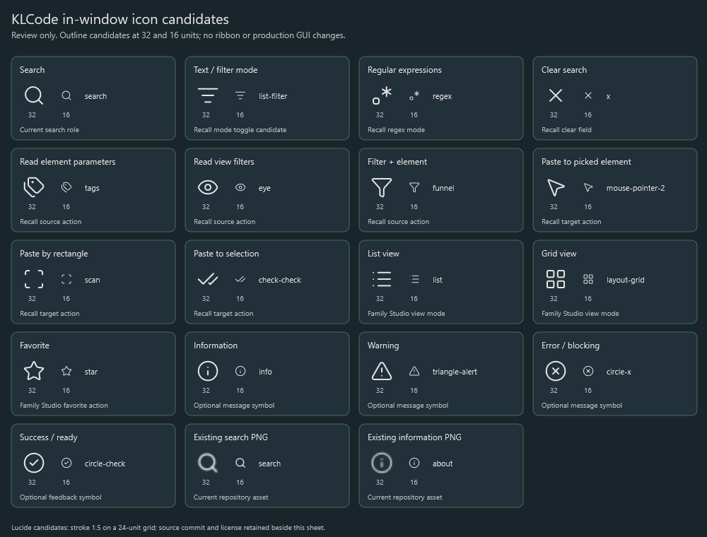

# In-window icon selection

Date: 2026-10-28. Baseline: `bb78f0d` on `dev.GUI-Clean`.
The owner requested icon selection followed by production migration and supplied
the [Lucide catalog](https://lucide.dev/icons/) as the source family.
The [consolidation plan](../../../../plans/custom-window-consolidation.md) owns
decisions and migration status. This directory preserves the reviewed candidates. The owner approved all four
choices; the production source owner is now [lib/_icons/gui](../../../../../lib/_icons/gui/README.md).

The sheet renders candidate geometry through WPF at 16 units and enlarged at 32.
Candidates use the current KLWhite on charcoal and a proposed 1.5-unit stroke
on the 24-unit view box, matching the existing repository SVG treatment. Source
SVGs retain their upstream stroke attributes; the review renderer supplies the
proposed appearance. The existing search/about PNGs appear for comparison.
The sheet was rendered and visually inspected. Nothing was adopted by a tool.

## Proposed mappings

| Role | Candidate | Current use |
| --- | --- | --- |
| Search | search | Search PNG in SelectFromDict, CreateFromRooms, Steel PSF; emoji in Family Studio |
| Text/filter mode | list-filter | Recall's filled funnel/AZ mode icon |
| Regular expressions | regex | Recall's filled asterisk/dot mode icon |
| Clear search | x | Recall's filled X |
| Read element parameters | tags | Recall's filled multiple-tag shape |
| Read view filters | eye | Recall's filled eye |
| Filter plus element | funnel | Recall's filled funnel |
| Paste to picked element | mouse-pointer-2 | Recall's filled cursor |
| Paste by rectangle | scan | Recall's corner-selection shape |
| Paste to current selection | check-check | Recall's double-check shape |
| List view | list | Family Studio's text glyph |
| Grid view | layout-grid | Family Studio's text glyph |
| Favorite | star | Family Studio's star glyph |
| Information | info | Alert i glyph; optional Message heading symbol |
| Warning | triangle-alert | Alert exclamation glyph; optional Message heading symbol |
| Error/blocking | circle-x | Blocking-issue exclamation; optional Message heading symbol |
| Success | circle-check | Optional feedback symbol; no new success classification proposed |

The existing approved Ready/Warning/Blocked chips use words and colored borders.
Whether to add symbols to message headings is a separate owner choice. Browse,
Reset, Copy Report, Copy Path and Open Folder currently use text buttons; adding
icons to those actions is also a separate choice. Existing text labels and
workflow semantics do not derive from the icon assets.

## Source evidence

- Search: `lib/GUI/SelectFromDict.xaml:101`,
  `lib/GUI/Tools/CreateFromRooms.xaml:102`, Steel PSF's `SteelPsfDialog.xaml:66`.
- Recall: `lib/match/clipboard.Icons.xaml` owns the current vector shapes;
  `clipboard_content.xaml:16-47,114-210` composes its compact controls/actions.
- Family Studio: `FamilyStudioWindow.xaml:57` contains the search emoji;
  `ResourceDictionary.en_us.xaml` contains the List/Grid/Favorite glyph labels.
- Alerts: `lib/GUI/CustomAlert.xaml:54-55`,
  `src/KLCode.Wpf/Views/KlaAlertWindow.xaml.cs:34-52`, and Startup Importer's
  `BlockingIssuesWindow.xaml:18` contain the current symbols.

A read-only second pass reviewed actual standalone-window icon use, excluding
ribbon buttons and docked panels. Most larger actions are text-only. Recall's
content is shared with a docked host, so migration must preserve that consumer
or isolate the standalone adapter rather than changing it accidentally.

## Provenance and reproduction

The 17 SVGs are unmodified source candidates from the exact upstream commit in
[source.json](source.json). The [upstream license](LICENSE.lucide.txt) retains
Lucide's ISC notice and the Feather-derived MIT notices. See the official
[license](https://lucide.dev/license). No package or runtime dependency was added.

Run `render.ps1` with Windows PowerShell/WPF to recreate `contact-sheet.png`.
It reads only the local candidates and the repository's two existing PNGs.
This is a static asset review, not live-host or interactive icon-state evidence.
The owner subsequently approved the mappings, 1.5 stroke, optional message
symbols and text-only larger actions. This sheet remains the dated review
snapshot; edit approved artwork in the canonical GUI icon folder.
